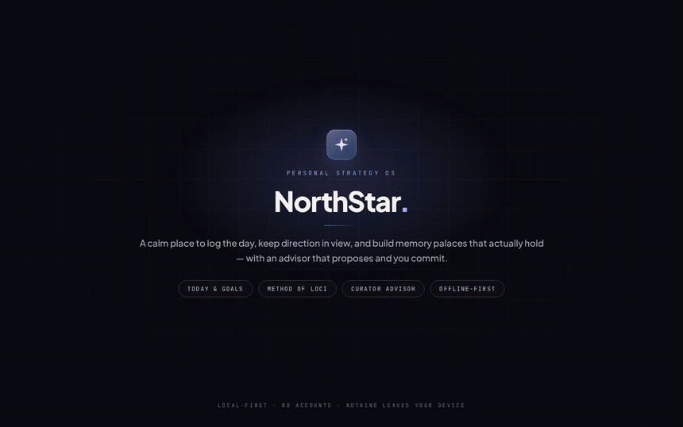

# NorthStar

[github.com/sahil2837j-eng/northstar](https://github.com/sahil2837j-eng/northstar)

A local-first personal strategy and memory OS. Today, goals, strategic memory, review, insights, history, a private guide, a practice engine, and a full Method of Loci trainer with a local-AI Curator.

Everything runs on this machine by default. There is no account, no sync, and no analytics. Local Ollama is the normal AI path; a remote cloud API is available only as an explicit, off-by-default opt-in. Node.js 20 or newer is required.

## Demo



[Watch the full 60-second MP4 demo](docs/media/northstar-demo.mp4).

## Run it

```bash
npm install
npm run dev
```

Open <http://127.0.0.1:5173>. The dev server proxies `/ollama` to Ollama on `127.0.0.1:11434`, so the local AI works without CORS setup. Remote AI uses the loopback server's `/api/remote` safety checks; run `npm start` on port 3000 alongside the dev server when you want to test remote mode.

For the production build:

```bash
npm run build
npm start
```

Open <http://127.0.0.1:3000>. The Node server binds to `127.0.0.1` only, serves `dist/`, proxies `/ollama/*` to the local Ollama instance, and exposes `GET /api/health`.

The one-click launcher starts the production server if needed and opens the app:

```bash
scripts/launch.sh
scripts/launch.sh --rebuild   # rebuild first
```

Use the same host and port each time. Browser storage is scoped to the exact origin, so `localhost` and `127.0.0.1` are separate notebooks.

## Local AI and API

The default endpoint is `/ollama` (the built-in loopback proxy). The default model is `qwen2.5:7b-instruct`.

- **Ollama**: start it normally (`ollama serve`). The app talks to it through `/ollama`; no `OLLAMA_ORIGINS` change is needed when you run the app through `npm start` or `npm run dev`.
- **OpenAI-compatible local server** (LM Studio, llama.cpp, vLLM): set the endpoint to `http://127.0.0.1:1234/v1` (or your server's URL) and the model name in Settings or Loci Settings. The provider is detected from the URL.
- **Test connection**: Settings → Optional AI mentor → Test connection; Loci Settings → Local AI Cue Assistant → Test local AI connection. The Loci settings page also reports whether the configured model is present.
- **CPU speed**: on a machine without a GPU, `qwen2.5:7b-instruct` can take 30–70 seconds for a cold reply. The Guide and Mentor wait up to 2 minutes; Loci cue suggestions wait up to 60 seconds and then fall back to a deterministic cue. A smaller model (for example `qwen2.5:3b-instruct`) is faster if you prefer.
- **Privacy rule**: by default, only loopback endpoints or the same-origin `/ollama` proxy are accepted. Remote endpoints are rejected before any request is made unless you explicitly enable the remote cloud API below. AI calls are user-initiated; nothing polls or runs in the background unless you explicitly enable auto-briefings, which always require a loopback endpoint.

`GET /api/health` reports the app version, the proxy target, whether Ollama is reachable, and the installed model names.

## Remote cloud API (opt-in)

Remote AI is off by default. When you enable it in **Settings → Remote cloud API** (or **Loci Settings → Remote cloud API**), the Guide, Mentor, Loci cue helper, and Curator can use an OpenAI-compatible or Anthropic endpoint instead of local Ollama. Auto-briefings stay local-only.

- **Key storage**: keys never enter the notebook, exports, health responses, or logs. By default a key lives in this tab's `sessionStorage` and disappears when the browser closes; “Remember the key on this device” moves it to this browser profile's `localStorage` until you remove it.
- **Transport**: the browser sends the key only to the loopback app server at `/api/remote`. The server accepts HTTPS only, rejects credentials in the URL, resolves the host, refuses loopback/private/reserved addresses, pins the connection to the resolved public address, refuses redirects, and never logs the key or request body.
- **Scope**: only the payload shown in the relevant preview is sent. The remote key is excluded from every export. Turning the toggle off returns every call to local AI.
- **Connection test**: the test button sends one tiny request (`max_tokens: 1`) to the endpoint you entered. It is a real request and may count against your provider quota.

## Login autostart

The app can start quietly at login, without opening a browser:

```bash
scripts/autostart.sh enable
scripts/autostart.sh status
scripts/autostart.sh disable
```

This writes `~/.config/autostart/northstar.desktop`, which runs `scripts/launch.sh --quiet`. The launcher detects an already-running NorthStar and does not start a second copy. Login autostart is user-controlled; disable it with the command above.

## What is inside

- **Today / Goals / Memory / Review / Insights / History** — the strategy layer. Strategic Memory holds up to 8 active user-authored principles, decisions, lessons, or open questions. It is context for the Strategist, never journal evidence, never a pattern, and never mixed with Loci.
- **Loci** — a real Method of Loci trainer: build a route through a familiar place, place one item per spot, approve a vivid cue, walk the route to encode it, then recall on a spaced schedule. Includes first-walk encoding, hidden recall, a graded hint ladder, reverse/random modes, aphantasia-friendly story mode, IndexedDB images, export/import, a sample palace, and a seeded **My Home Route** (13 spots, empty by design so you place your own items).
- **Curator** — an advisory layer for Loci: interference guard, route doctor, hint ladder, session planner, cue critic, command bar, and load advisor. It proposes; you confirm. Every module has a deterministic fallback.
- **Guide / Mentor** — one private question and a persona-toned mentor. Replies are validated for exactly one question and no shame language.
- **Practice** — a sandboxed exercise engine with a contract, schedule, sessions, and ledger.

## Tests

```bash
npm run check          # typecheck + all Node tests (including migration and remote) + production build
npm run test:browser   # Playwright check of Loci + Curator (needs a running server)
```

For the browser check:

```bash
npm run build
PORT=5211 npm start &
CHROMIUM_PATH=/usr/bin/chromium npm run test:browser
```

## Data and backups

- Main notebook: `localStorage` keys under `northstar.*`.
- Strategic Memory: `northstar.memory.v1` (the same key the old Northern v2 build used, so old memories load automatically; active memory is capped at 8 and extra active items are archived, not deleted).
- Loci palaces, sessions, and settings: `localStorage` key `loci:v1`.
- Loci images: IndexedDB.
- Export/import lives in Settings and Loci Settings. Backups include the main notebook and Loci data; image export is optional. Remote API keys are never included.
- **Old data migration**: on first load, the app imports the old `northstar.loci.v1` palaces and sessions into `loci:v1` once, mapping old spots/items and review schedules. The marker `loci:legacyMigrated` prevents re-importing after you delete an imported palace. Old strategic memories need no copy because the key is shared.

Storage is plain `localStorage` / IndexedDB, not encrypted. Clearing site data, switching browsers, or switching devices loses the notebook unless you export first.

## Notes

- The app starts with a sample palace so the trainer is explorable, plus **My Home Route** (13 spots, no items). Delete the sample when you no longer need it. My Home Route is added once; if you delete it, it stays deleted.
- The previous Northern v2 build is kept locally as a backup; this repository is the new NorthStar base.
- The only third-party request in the UI is the Google Fonts stylesheet in `index.html`. Remove that link for a fully offline build; the app falls back to system fonts.

## License

MIT. See [LICENSE](LICENSE).
